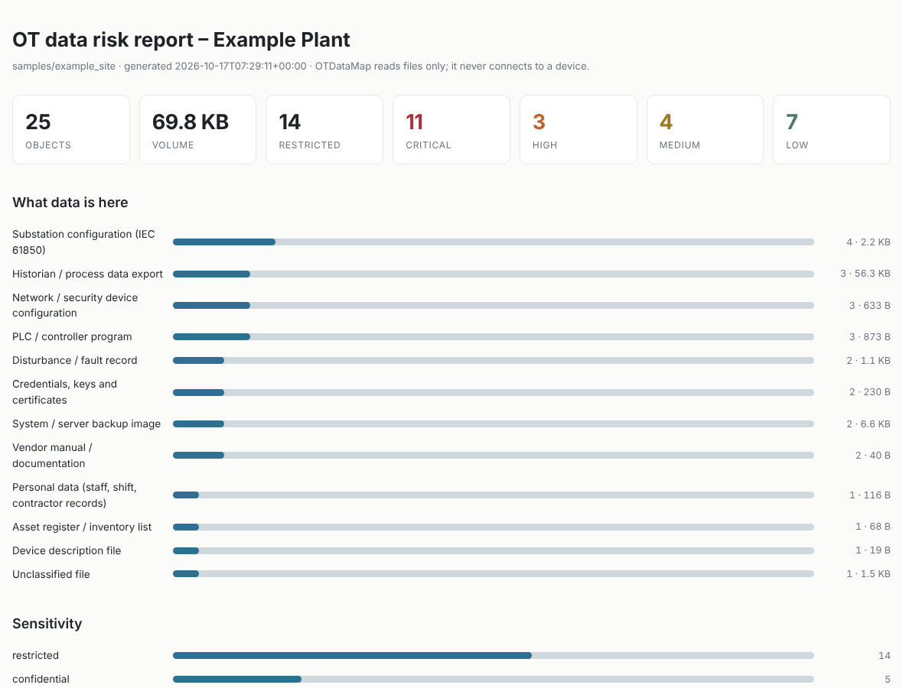
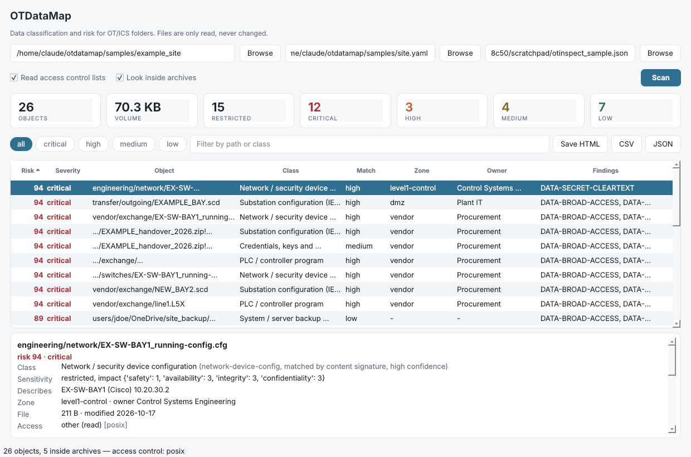

# OTDataMap

**Where does OT data actually live, how sensitive is it, and which copies are in the wrong place?**

Most OT security tooling looks at devices and traffic. OTDataMap looks at the *data*: the
substation configurations, PLC programs, historian exports, backups, drawings and rosters
that pile up on file shares, engineering laptops, vendor folders and somebody's OneDrive.

Point it at a folder and it produces a **data inventory with a classification and a risk
score for every object**, plus findings for the copies that should not be where they are.

It only **reads files**. It never connects to a device and never writes to the folder you scan.

> **Status: alpha.** Rules and scoring are deliberately simple and fully editable in YAML.
> If a file is misclassified, that is a bug worth reporting — the catalogue is the product.



```
25 objects, 69.8 KB, 14 restricted, 5 inside archives
  access control: icacls
  critical: 11  high: 3  medium: 4  low: 7

findings:
    11  DATA-BROAD-ACCESS
    11  DATA-SECRET-CLEARTEXT
     9  DATA-RESTRICTED-IN-SHARED
     8  DATA-OUTSIDE-ZONE
     4  DATA-UNDECLARED-STORE
     3  DATA-SPRAWL-DUPLICATE
     1  DATA-RESTRICTED-EGRESS
     1  DATA-RETENTION-EXCEEDED
     1  DATA-STALE
```

## Try it in 30 seconds

No real data required — the repo ships a fabricated site:

```bash
pip install -e .
python samples/make_samples.py
otdatamap scan samples/example_site --model samples/site.yaml --html report.html
```

Open `report.html`. It is a single self-contained file: no network, no external assets,
light and dark theme, safe to hand to a plant manager.

Prefer a window to a terminal?

```bash
pip install "otdatamap[gui]"
otdatamap gui
```



Pick a folder, press Scan, click any row to see why it was flagged — the class it matched
and how, who can read it, which device it describes, every signal, and each finding with its
62443 / ATT&CK reference and the fix. Filter by severity, search by path or class, sort by
any column, and save the HTML, CSV or JSON from the same window. It follows the system
light or dark theme. The GUI is a thin shell over the same engine as the CLI, so the two
can never disagree.

## What it does

**1. Classifies every file into an OT data class.** 17 classes out of the box, matched by
extension, file name and content signature — content wins, so a COMTRADE `.cfg` is a
disturbance record and a Cisco `.cfg` is a device configuration.

| Class | Sensitivity | Why it matters |
|---|---|---|
| `substation-config` (SCD/ICD/CID/SSD) | restricted | Describes protection and GOOSE wiring of a whole bay |
| `plc-program` (L5X, TIA, XEF, CODESYS) | restricted | The control logic itself |
| `hmi-project`, `network-device-config`, `credential-store`, `system-backup` | restricted | |
| `process-capture`, `historian-export`, `engineering-drawing`, `asset-register`, `personal-data`, `firmware-image` | confidential | |
| `disturbance-record`, `log-data`, `device-description`, `vendor-document` | internal | |

Every object also carries a **confidence**: `high` when a content signature matched,
`medium` for a file-name pattern, `low` for an extension alone. A low-confidence
classification is a guess, and the report says so rather than hiding it.

**Archives are opened in place.** A contractor handover is almost always one `.zip`, and a
Siemens TIA export is a `.zapXX` — which is also a zip. Members are listed and classified
without extracting anything, and they inherit the archive's location, so a PLC program
inside a zip in the vendor folder is still in the vendor folder. Zip bombs, path traversal
and absolute member paths are rejected; Office files are not opened.

`otdatamap classes` prints the full catalogue. Every entry carries a **sensitivity**, an
**impact rating** (safety / availability / integrity / confidentiality — safety and
availability weigh heaviest, which is what makes this an OT catalogue rather than an IT one)
and a **retention period**.

**2. Reads who can actually open it.** This is the difference between a guess and evidence.
A folder named `vendor` is a hint; `Everyone:(RX)` on the file is proof. OTDataMap reads the
real ACL — `icacls` on Windows, `getfacl` or the POSIX mode elsewhere — and flags sensitive
objects granted to broad principals (Everyone, Authenticated Users, Domain Users, world).
ACLs are read per directory and cached, so a large share costs one call per folder, not one
per file. `--no-acl` turns it off.

**3. Detects exposure.** For each object: where it sits (shared area, vendor folder,
cloud-synced folder, removable media, personal desktop), cleartext secrets inside it,
identical copies spread across folders, age against its retention rule.

**4. Scores and explains.** Risk = class sensitivity and impact (max 45) + exposure signals
(max 55). Each finding carries the **IEC 62443-3-3 system requirements** it gives evidence
against and the related **MITRE ATT&CK for ICS** techniques, plus a remediation line.

| Rule | Severity | Raised when |
|---|---|---|
| `DATA-SECRET-CLEARTEXT` | critical | A password, SNMP community or private key sits in a data object |
| `DATA-RESTRICTED-EGRESS` | critical | Restricted data in a cloud-synced folder or on removable media |
| `DATA-RESTRICTED-IN-SHARED` | high | Restricted data in a shared, vendor or personal area |
| `DATA-OUTSIDE-ZONE` | high | Object above the maximum class its zone allows |
| `DATA-BROAD-ACCESS` | high* | Everyone / Domain Users / world can read sensitive data (*critical if they can write it*) |
| `DATA-SPRAWL-DUPLICATE` | medium | The same content in three or more folders |
| `DATA-UNDECLARED-STORE` | medium | Sensitive data in a folder the site model never mentions |
| `DATA-RETENTION-EXCEEDED` / `DATA-STALE` | medium | Kept too long, or a backup that stopped being refreshed |
| `DATA-NO-OWNER` | medium | Sensitive data in a zone with nobody named |

**5. Checks against your zones.** An optional site model maps folders to IEC 62443 zones
with a maximum data class, an SL-T and an owner. That turns *"this file looks sensitive"*
into *"this file is two classes above what its zone allows, and it belongs to Control
Systems Engineering"*.

```bash
otdatamap init-model -o site.yaml      # starter model, edit the paths
otdatamap scan /mnt/plant_share --model site.yaml --html report.html
```

```yaml
zones:
  - id: dmz
    name: IT/OT DMZ
    sl_t: 2
    max_class: internal        # anything above this is a finding
    owner: Plant IT
    paths: [dmz, transfer]
```

## Tell me what changed

A single scan says "47 objects are restricted", which shocks a room once and is then
ignored. A delta says "three restricted files appeared in the vendor folder this week" —
and that is the reason anyone runs the tool a second time.

```bash
otdatamap scan ./site --save-baseline 2026-10.json          # this month
otdatamap scan ./site --baseline 2026-10.json               # next month, with the delta
otdatamap diff 2026-10.json 2026-11.json --fail-on-new high # or compare two saved runs
```

```
change since the baseline:
since 2026-10-17T06:31:15+00:00
     1  new objects
     3  new findings
     0  resolved findings
     0  objects whose risk went up

new high or critical findings:
  [high] DATA-RESTRICTED-IN-SHARED  vendor/exchange/NEW_BAY2.scd
```

## Which device is this file for?

[OTInspect](https://github.com/lindseynguyen/ReadingDataOT) parses OT files and knows which
devices they describe. OTDataMap knows how sensitive a file is and who can read it. Feed one
into the other:

```bash
otinspect scan ./site --json otinspect.json
otdatamap scan ./site --from-otinspect otinspect.json --html report.html
```

```
  class      network-device-config (Network / security device configuration)
             matched by content signature -> high confidence
  describes  EX-SW-BAY1 (Cisco) 10.20.30.2
```

Matching is by file name, and the reader is forgiving: an OTInspect report it cannot
understand yields "no devices matched" rather than an error.

## Why was this flagged?

The honest risk with any rule engine is a confident false positive. `--explain` prints the
whole trace, so an operator can argue with it:

```bash
otdatamap scan ./site --explain --top 5
```

```
transfer/outgoing/EXAMPLE_BAY.scd
  class      substation-config (Substation configuration (IEC 61850))
             matched by content signature -> high confidence
  sensitivity restricted, impact {'safety': 3, 'availability': 3, ...}
  describes  IED_PROT_01 (ExampleVendor EX-500) 10.20.30.11
  zone       dmz (owner Plant IT)
  access     other (read) [posix]
  signals    Shared or transfer area (+3), Broad access (+4), Above zone class (+4)
  risk       94 -> critical
    [high] DATA-OUTSIDE-ZONE: restricted data in zone 'dmz' (max internal)
```

## Outputs

```bash
otdatamap scan ./site --html report.html --json inventory.json --csv inventory.csv
otdatamap scan ./site --fail-on high      # exit code 2 — use it in a pipeline
otdatamap scan ./site --no-acl            # skip ACLs on a very large share
otdatamap scan ./site --no-archives       # do not open zip / TIA packages
```

- **HTML** — summary cards, what data is here, sensitivity split, per-zone table, findings
  with 62443/ATT&CK mapping, and the flagged objects ranked by risk
- **JSON** — every object with its class, signals, findings and SHA-256
- **CSV** — the data inventory itself, ready for the register you have to maintain anyway

## Make it yours

The two YAML files under `otdatamap/rules/` are the whole brain of the tool, and both can be
overridden without touching code:

```bash
otdatamap scan ./site --classes my_classes.yaml --rules my_exposure.yaml
```

- `--classes` adds or replaces data classes (same `id` wins over the default)
- `--rules` changes path patterns, secret regexes, thresholds and severity bands

Site naming conventions differ everywhere, so the location patterns (`*/vendor*/*`,
`*/onedrive*/*`, …) are the first thing most people will want to edit.

## Install

```bash
git clone https://github.com/lindseynguyen/otdatamap.git
cd otdatamap
pip install -e .
```

Python 3.9+ and PyYAML for the command line; `pip install -e ".[gui]"` adds PyQt5 for the
desktop interface.

## Scope and honesty

- It reads file **content** only for text-like files, and only the first 256 KB.
- It does not open proprietary binary projects (TIA, ACD, WinCC); those are classified by
  name and extension. Pair it with a parser-level tool when you need what is inside.
- Risk scores are a prioritisation aid, not an assessment. The 62443 and ATT&CK references
  are evidence pointers for a human assessor, not a compliance verdict.
- It reads ACLs, but it does not expand Active Directory groups: a custom group granted
  Read is reported as that group, not as the 300 people in it. Nor does it know who actually
  opened a file — that is an audit log question.
- Archive support is zip-based (`.zip`, `.zapXX`, `.apa`). 7z and RAR are not opened.

## Contributing

The most valuable contribution is a **class that is wrong for your plant**: a file type that
is misidentified, a vendor naming convention the patterns miss, or a data class that matters
where you work and is not in the catalogue. Open an issue with the file extension, a
sanitised name pattern and what it should be.

MIT licensed.
